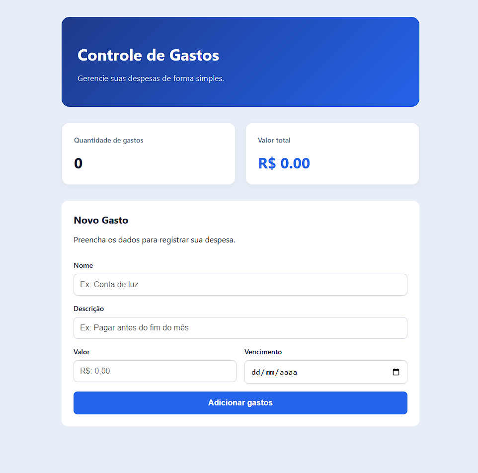
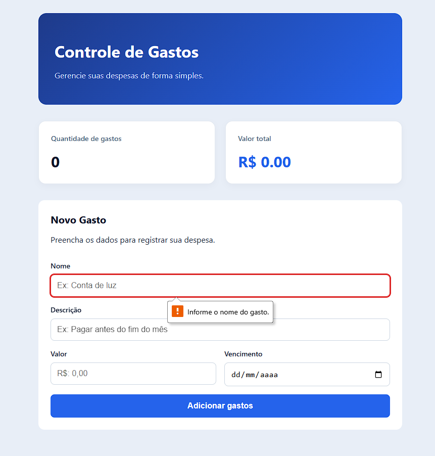
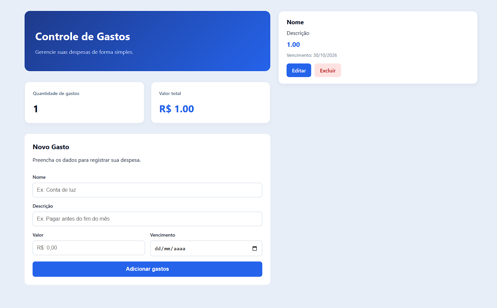

<h1 align="center">Controle de Gastos</h1>

<p align="center">
  Aplicação web para cadastrar, consultar, editar e excluir gastos, com resumo dos valores registrados.
</p>

<p align="center">
  <a href="https://github.com/SDinee/ControleGastos/commits/main"></a>
  
</p>

## Sobre o projeto

O Controle de Gastos permite registrar despesas com nome, descrição, valor e vencimento. A página mostra a quantidade de gastos e o valor total cadastrado.

O projeto é executado localmente e é composto por uma API em ASP.NET Core e uma interface em React.

## Capturas de tela

| Página inicial | Campos obrigatórios | Página inicial com gasto |
|---|---|---|
|  |  |  |

## Tecnologias

**Frontend:** React, Vite e CSS.  
**Backend:** ASP.NET Core, Entity Framework Core.<br>
**Banco:** SQLite

## Funcionalidades

- Cadastro, edição e exclusão de gastos.
- Listagem dos gastos cadastrados.
- Resumo com quantidade de gastos e valor total.
- Validação dos campos e apresentação de mensagens de erro.

## Validações

A API valida os dados recebidos:

- Nome obrigatório, com até 50 caracteres.
- Descrição obrigatória, com até 100 caracteres.
- Valor mínimo de R$ 0,01.
- Vencimento entre 01/01/2000 e 31/12/2999.

## Requisitos

- .NET 10 SDK para restaurar e executar a API.
- Node.js e npm para instalar e executar o frontend.
- Ferramenta `dotnet-ef` para aplicar as migrations do banco.

## Endpoints da API

A rota base é `/api/gastos`.

| Método | Rota | Ação |
|---|---|---|
| `GET` | `/api/gastos` | Lista os gastos |
| `POST` | `/api/gastos` | Cadastra um gasto |
| `PUT` | `/api/gastos/{id}` | Atualiza um gasto |
| `DELETE` | `/api/gastos/{id}` | Exclui um gasto |


## Preparar o ambiente

No Windows, abra o PowerShell e instale o .NET SDK e o Node.js:

```powershell
# Instala o SDK do .NET 10, necessário para executar a API
winget install --id Microsoft.DotNet.SDK.10 --source winget

# Instala o Node.js, que também inclui o npm
winget install --id OpenJS.NodeJS --source winget
```

Feche e abra novamente o PowerShell, depois confira se as ferramentas estão disponíveis:

```powershell
# Mostra a versão instalada do .NET SDK
dotnet --version

# Mostra a versão instalada do Node.js
node --version

# Mostra a versão instalada do npm
npm --version
```

Se a ferramenta dotnet-ef ainda não estiver instalada, instale-a para aplicar as migrations:

```powershell
# Instala o comando dotnet-ef globalmente, caso ele ainda não esteja disponível
dotnet tool install --global dotnet-ef

# Confirma que o comando dotnet-ef está disponível
dotnet ef --version
```

Se `dotnet-ef` já estiver instalado, mas precisar ser atualizado, use:

```powershell
# Atualiza a ferramenta dotnet-ef global já instalada
dotnet tool update --global dotnet-ef
```

Os comandos `dotnet restore` e `npm ci`, nas etapas abaixo, instalam as dependências específicas do backend e do frontend a partir dos arquivos do projeto.

## Executar localmente

Abra dois terminais na pasta raiz do repositório: um para a API e outro para o frontend. Execute os comandos na ordem indicada.

### 1. Iniciar a API

No primeiro terminal:

```powershell
# Entra na pasta do projeto da API
Set-Location .\backend\ControleGastos.Api

# Baixa e prepara as dependências do projeto .NET
dotnet restore

# Cria a pasta onde ficará o banco SQLite, se ela ainda não existir
New-Item -ItemType Directory -Force .\Data\Banco

# Aplica as migrations e cria ou atualiza a estrutura do banco de dados
dotnet ef database update

# Inicia a API usando a configuração HTTP do projeto
dotnet run --launch-profile http
```
A API ficará disponível em http://localhost:5121

### 2. Iniciar o frontend

No segundo terminal:

```powershell
# Entra na pasta do projeto React
Set-Location .\frontend\controle-gastos-web

# Cria a configuração local a partir do arquivo de exemplo
Copy-Item .env.example .env.development

# Instala as dependências definidas no package-lock.json
npm ci

# Inicia o servidor de desenvolvimento do Vite
npm run dev
```

Abra no navegador o endereço informado pelo Vite no terminal, normalmente `http://localhost:5173`.

A variável `VITE_API_URL` no arquivo `.env.development` define o endereço da API. O arquivo `.env.example` contém a configuração padrão para execução local.

## Estrutura do projeto

```text
backend/
  ControleGastos.Api/
    Controllers/
    Data/
    Migrations/
    Models/

frontend/
  controle-gastos-web/
    src/
      components/
      pages/
      services/

docs/
  screenshots/
```

## Autor

<p align="center">
  <br>
  <strong>Sidne Cabo</strong>
</p>

<p align="center">
  <a href="https://www.linkedin.com/in/sidne-cabo" target="_blank">
    
  </a>
</p>

<p align="center">
  Projeto desenvolvido para fins acadêmicos e de aprendizado.
</p>